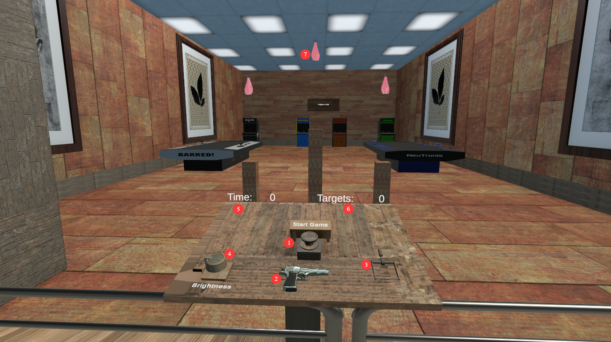

# Unity Range Shooter

A simple VR shooting-range game built in Unity. Players explore an indoor range, pick up a handgun, and shoot bottle targets during a timed round. The project combines controller-based interaction, physics-driven shooting, and in-world feedback.

- **Grab, aim, and shoot:** pick up the handgun with a VR controller and use the trigger to fire projectiles.
- **Breakable targets:** bottles shatter when hit. Replacement bottles appear after a short delay.
- **Timed rounds and scoring:** shoot targets during a 30-second round while an in-world display shows the remaining time and score.
- **Movement and interaction:** move and turn with the controller joysticks and interact with objects in the environment.

The scene also includes a physics-based ball interaction: a designated bottle target launches a ball toward a fixed point when broken, and the ball awards an additional point when it reaches a scoring zone.

## Screenshot

1. **Start game button** — begins a new round.
2. **Pistol** — grab, aim, and shoot.
3. **Light switch** — turns the lights on or off.
4. **Brightness knob** — adjusts the lighting brightness.
5. **Timer** — shows the remaining time.
6. **Targets hit counter** — shows the number of targets hit.
7. **Bottle target** — shoot the bottle to score.

## About the project

Built with Unity and C#. The main scene is `XRITOOLKIT/Assets/ProjectFinalScene.unity`.

